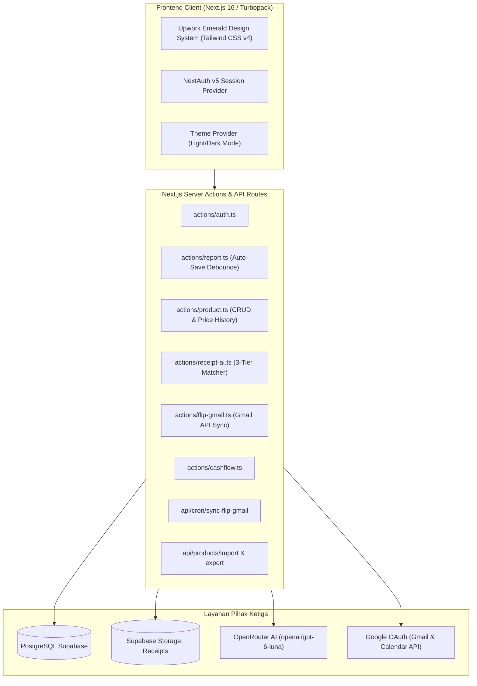
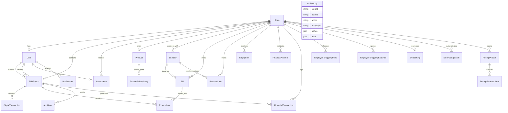

# 🛒 PRD — KasirPro (Aplikasi Kasir, Laporan Shift & Manajemen Keuangan Minimarket)
**Versi Dokumen:** 3.1 (19 Oktober 2026 — Security Hardening & Log Aktivitas)  
**Status Sistem:** Production Live ([kasir-pro-three.vercel.app](https://kasir-pro-three.vercel.app))  
**Tech Stack:** Next.js 16 (App Router + Turbopack), TypeScript, Tailwind CSS v4, Prisma ORM v6, PostgreSQL Supabase, OpenRouter Vision AI (GPT Luna), SheetJS (`xlsx`), Google Calendar & Gmail OAuth API.

---

## 1. Executive Summary & Visi Produk

**KasirPro** adalah platform web modern kelas enterprise yang dirancang khusus untuk memodernisasi dan mengotomatisasi seluruh operasional ritel minimarket/toko retail multi-cabang. Aplikasi ini memecahkan berbagai masalah klasik ritel konvensional, antara lain:
1. **Risiko Selisih Kas Fisik Kasir**: Menghilangkan selisih perhitungan uang manual dengan kalkulasi otomatis antara modal laci, penjualan POS (Cash & Debit), setoran kasir, pembayaran tagihan supplier, dan mutasi layanan digital.
2. **Keterlambatan Deteksi Kenaikan Harga Modal Supplier**: Supplier sering menaikkan harga modal tanpa pemberitahuan tertulis. KasirPro memperkenalkan **Ekstraksi Nota AI (GPT Luna)** dan **Audit Trail Kenaikan Modal**, yang otomatis membaca foto nota belanja kasir, membandingkan harga beli dengan database, dan memicu peringatan untuk penyesuaian harga jual.
3. **Rekonsiliasi Transaksi Digital Tanpa Delay**: Mengintegrasikan mutasi Flip secara otomatis via Gmail OAuth API dengan pembatasan rentang jam shift (*Shift Window*), memastikan transaksi e-wallet/pulsa/PLN tidak terlewat dan tidak terjadi peringatan ganda di shift lain.
4. **Sentralisasi Buku Kas, Tagihan, dan Kas Kecil**: Mengintegrasikan Buku Kas Toko (`/admin/cashflow`), Tagihan Supplier tersinkron Google Calendar (`/cashier/bills`), Kas Kecil Belanja Pegawai (`/shopping-funds`), hingga pencatatan Barang Retur (`/retur`) dan Barang Kosong Publik (`/empty-items`).

---

## 2. Arsitektur & Teknologi

### Karakteristik Desain UI/UX (Upwork Emerald Theme):
- **Warna Utama**: Upwork Emerald Green (`oklch(0.55 0.19 142)` / `#108a00` - `#16a34a`), background bersih off-white (`oklch(0.982 0.002 120)`).
- **Layout**: Hairline border cards `border-border/80`, rounded corner `rounded-2xl`, status pill badges (`upwork-badge-emerald`, `upwork-badge-amber`, `upwork-badge-rose`).
- **Brand Favicon**: Terintegrasi penuh dengan logo Storefront hijau emerald KasirPro di tab browser dan perangkat mobile.

---

## 3. Matriks Peran Pengguna (RBAC)

Sistem mengadopsi *Role-Based Access Control* (RBAC) yang ketat dan terisolasi per toko (`storeId` multi-tenant):

| Fitur / Modul | Super Admin | Admin | Kasir | Pramuniaga |
| :--- | :---: | :---: | :---: | :---: |
| **Pendaftaran Toko & Profil Cabang** | ✅ Full | ❌ | ❌ | ❌ |
| **Manajemen User & Siklus Gaji** | ✅ Full | ✅ Toko | ❌ | ❌ |
| **Dashboard Analytics & Leaderboard** | ✅ Full | ✅ Toko | ❌ | ❌ |
| **Verifikasi Setoran Kasir** | ✅ Full | ✅ Toko | ❌ | ❌ |
| **Buku Kas Toko (`/admin/cashflow`)** | ✅ Full | ✅ Toko | ❌ | ❌ |
| **Master Data Barang (`/products`)** | ✅ Full | ✅ Full | 👁️ Lihat + Scan Nota AI | 👁️ Lihat + Scan Nota AI |
| **Import Excel Barang** | ✅ Full | ✅ Full | ❌ | ❌ |
| **Export Excel Barang** | ✅ | ✅ | ✅ | ✅ |
| **Form Laporan Shift (`/cashier/report`)** | ✅ Audit | ✅ Audit | ✅ Full (Laporan Sendiri) | ✅ Jika Override Role |
| **Edit Entri Setelah Laporan Dikirim** | ✅ (kecuali Verified) | ✅ (kecuali Verified) | ❌ (lewat revisi) | ❌ |
| **Kelola Akun Super Admin (buat/edit/reset PIN)** | ✅ | ❌ | ❌ | ❌ |
| **Rekap Gaji Pegawai** | ✅ | ✅ | ❌ (hanya data sendiri) | ❌ (hanya data sendiri) |
| **Log Aktivitas (`/admin/audit-log`)** | ✅ Lihat | ✅ Lihat | ❌ | ❌ |
| **Hubungkan / Putus Google (Calendar, Gmail)** | ✅ | ✅ | ❌ | ❌ |
| **Cetak Struk Termal (58mm/80mm)** | ✅ | ✅ | ✅ | ✅ |
| **Presensi Clock-In / Clock-Out** | ✅ | ✅ | ✅ | ✅ |
| **Kas Kecil Belanja (`/shopping-funds`)** | ✅ Hapus/Koreksi | ✅ Catat | ✅ Catat Belanja | ✅ Catat Belanja |
| **Tagihan Supplier (`/cashier/bills`)** | ✅ | ✅ | ✅ | ✅ |
| **Barang Retur Supplier (`/retur`)** | ✅ | ✅ | ✅ | ✅ |
| **Barang Kosong & Share Publik** | ✅ | ✅ | ✅ | ✅ |
| **Pengaturan Toko & AI Nota Switch** | ✅ | ✅ | ❌ | ❌ |

---

## 4. Pemetaan Lengkap 19 Modul & Rute Halaman

### Modul 1: Otentikasi & Setup Toko
- **`/register`**: Pendaftaran awal untuk toko baru dan akun Super Admin pertama.
- **`/login`**: Otentikasi cepat kasir/admin menggunakan Email dan PIN terenkripsi Bcrypt. Dilengkapi *hard-cache clearance* untuk mencegah kebocoran sesi toko antar perangkat.
- **`/change-pin`**: Fasilitas mandiri seluruh pegawai untuk memperbarui PIN keamanan mereka sewaktu-waktu.

### Modul 2: Presensi Pegawai & Monitoring Shift
- **`/attendance`**: Form Clock-In dan Clock-Out harian. Mewajibkan pemilihan jenis shift (Pagi, Siang, Malam), upload foto selfie kehadiran, dan opsi *checkbox* "Bertugas Sebagai Kasir Hari Ini" bagi pramuniaga.
- **`/attendance/history`**: Riwayat presensi pribadi karyawan beserta total jam kerja dan status kehadiran.
- **`/admin/attendance`**: Rekapitulasi presensi seluruh karyawan cabang, monitoring siapa yang sedang aktif bertugas secara *live*, dan rekap siklus penggajian bulanan.

### Modul 3: Pusat Kendali Admin & Analitik Keuangan (`/admin/dashboard`)
- **Kartu Omzet Real-Time Hari Ini**: Memantau penjualan bersih POS hari ini yang independen dari filter tanggal.
- **Filter Rentang Waktu Komprehensif**: `Hari Ini`, `7 Hari`, `30 Hari`, `90 Hari`, `Tahun Ini`, dan `Semua (All Time)`.
- **Analisis Weekday vs Weekend**: Menghitung *Weekend Surge %*, rata-rata omzet per shift, serta perbandingan rasio transaksi Tunai vs Non-Tunai (Debit/QRIS).
- **Smart Recommendations Engine**: Menampilkan jawara laba digital, kasir omzet tertinggi, peluang upselling, dan peringatan jika akurasi kas fisik kasir turun di bawah 80%.
- **Leaderboard Kasir**: Peringkat kasir dengan metrik: Medali (🥇 🥈 🥉), Jumlah Shift, Total Omzet, % Debit, Laba Digital, dan Akurasi Kas Fisik.

### Modul 4: Form Laporan Shift Kasir (`/cashier/report` & `/cashier/report/[id]/print`)
- **Seksi 1 (Info Shift & Modal)**: Auto-fill nama kasir, shift, tanggal, modal awal laci kasir, dan **Uang Tagihan Diterima** (`billMoneyReceived`) dari shift sebelumnya.
- **Seksi 2 (POS)**: Input Penghasilan POS Cash dan POS Debit.
- **Seksi 3 (Layanan Digital)**: Input mutasi Top Up E-Wallet, Pulsa, Token PLN dengan pencocokan otomatis ID Flip dan penanda transaksi Non-Tunai.
- **Seksi 4 (Pengeluaran Toko)**: Input pengeluaran supplier dengan 3 sumber dana: Uang Tagihan, Uang Kasir, atau Transfer Bank. Dilengkapi upload foto nota terkompresi (wajib jika fitur AI toko aktif).
- **Seksi 5 (Rekapitulasi Kas)**: Perhitungan real-time Kas Seharusnya vs Hitung Fisik Manual kasir beserta live status selisih kas.
- **Peringatan Transaksi Flip Shift Window**: Menampilkan daftar transaksi digital Flip yang terjadi di jam shift kasir namun belum dimasukkan ke laporan. Transaksi yang sudah dilaporkan di shift lain otomatis dikecualikan.
- **Cetak Struk Thermal**: Format struk siap cetak ukuran 58mm atau 80mm untuk arsip fisik laci kasir.

### Modul 5: Verifikasi Setoran Admin (`/admin/verifications`)
- Menampilkan antrean laporan berstatus `Submitted`.
- **Split-View Audit**: Admin memeriksa rincian input kasir, memasukkan nominal selisih fisik aktual, dan memberikan catatan audit verifikasi.
- Persetujuan (*Approve*) mengunci laporan menjadi `Verified`, memicu notifikasi ke kasir, dan membukukan mutasi uang ke Buku Kas.

### Modul 6: Riwayat Laporan Kasir & Revisi Berizin (`/cashier/history`)
- Menampilkan seluruh arsip laporan shift kasir.
- Laporan yang sudah dikirim (`Submitted`) tetapi belum diverifikasi dapat direvisi dengan mencatat **Alasan Revisi** (ditambahkan ke catatan kasir dan tercatat di `ActivityLog` beserta nilai sebelum/sesudah). Status tidak bisa kembali ke Draft.
- Non-admin hanya dapat membuka laporan miliknya sendiri; laporan `Verified` terkunci.

### Modul 7: Transaksi Flip & Email Sync Webhook (`/admin/flip-transactions`)
- Menampilkan riwayat transaksi digital yang diekstrak otomatis dari email konfirmasi `flip.id`.
- **Fitur Sinkronisasi Cerdas**:
  - Filter rentang 3 hari terakhir (`after:YYYY/MM/DD`) untuk kecepatan optimal.
  - Pengambilan paralel multi-thread (batch 8 email) via Gmail OAuth API.
  - Indikator animasi loading berdenyut, tombol *Sinkronkan Gmail* manual, dan auto-timeout aman.
  - Tombol aksi: *Kecualikan/Aktifkan* transaksi non-kasir dan hapus (khusus Super Admin).
- **Endpoint Cron**: `/api/cron/sync-flip-gmail` untuk sinkronisasi otomatis via scheduler eksternal.

### Modul 8: Master Data Barang Toko (`/products`)
- Katalog inventaris per toko dengan variabel wajib: `itemCode` (SKU), `barcode`, `name`, `stock`, `costPrice`, `sellingPrice`, `unit`, dan `category`.
- **Import Excel (`/api/products/import`)**: Upload file `.xlsx` untuk insert/update massal. Jika harga modal di Excel lebih tinggi dari database, sistem otomatis mencatat riwayat kenaikan modal dan memberi alert jika harga jual belum disesuaikan.
- **Export Excel (`/api/products/export`)**: 1-klik unduh seluruh katalog barang toko dalam format Excel rapi beserta rumus margin laba.
- **Audit Trail Riwayat Kenaikan Modal (`PriceHistoryModal`)**: Mencatat riwayat harga permanen (modal lama vs baru, jual lama vs baru, selisih Rp dan %, sumber: Excel / Nota AI / Manual, dan foto nota bukti).
- Tombol aksi konfirmasi: **`[Tandai Sudah Disesuaikan di Aplikasi Kasir]`**.

### Modul 9: Ekstraksi Nota AI via OpenRouter (GPT Luna)
- Memanfaatkan Vision AI **`openai/gpt-6-luna`** (fallback `~openai/gpt-luna-latest`) melalui OpenRouter API.
- **Alur Kerja**:
  1. Kasir mengunggah foto nota struk belanja di laporan pengeluaran.
  2. AI mengekstrak baris barang, kuantitas, harga beli satuan, dan total belanja ke JSON terstruktur.
  3. **Algoritma 3-Tier Matcher**:
     - *Tier 1*: Pencocokan persis Barcode / ID SKU.
     - *Tier 2*: Pencocokan persis Nama Barang.
     - *Tier 3*: Pencocokan kemiripan teks cerdas (Fuzzy similarity).
  4. Jika harga modal naik: otomatis menandai peringatan `priceIncreased: true` dan mencatat riwayat harga.
  5. Jika item tidak cocok / ragu-ragu: user disajikan dialog pemetaan manual untuk memilih barang database, menandai *"Belum Ada di Kasir"*, atau 1-klik *"+ Tambah ke Data Barang"*.

### Modul 10: Pengaturan Toko & Sakelar AI Kontrol (`/admin/store-settings`)
- Pengaturan profil toko, alamat, dan zona waktu operasional (WIB / WITA / WIT).
- **Sakelar Kontrol Ekstraksi Nota AI (`enableAiReceiptScan`)**:
  - *Default: Nonaktif (OFF)*: Upload foto nota pengeluaran kasir bersifat opsional dan sistem berjalan normal seperti sedia kala.
  - *Saat Aktif (ON)*: Upload foto nota belanja kasir menjadi **wajib (*)** divalidasi sebelum laporan dikirim, dan proses ekstraksi AI dijalankan di latar belakang.
- Konfigurasi integrasi Google OAuth: Akun Gmail Flip dan Google Calendar.
- Master Pengaturan Jam Shift Toko (`ShiftSetting`).

### Modul 11: Buku Kas & Arus Kas Toko (`/admin/cashflow`)
- Buku besar pemasukan vs pengeluaran operasional toko.
- **Pemisahan Aliran Kas Verifikasi**: Memisahkan pencatatan *Uang Kas Diserahkan ke Verifikator* (fisik) dan *Setor Tunai ke Rekening Bank Perusahaan*.
- Rekapitulasi mutasi kas masuk, kas keluar, dan saldo kas operasional.

### Modul 12: Master Supplier Toko (`/admin/suppliers`)
- Manajemen direktori supplier toko: Nama, Kode unik, Alamat, Kontak PIC, dan Rekening Bank.
- Fasilitas Import massal supplier via file Excel (`/api/suppliers/import`).

### Modul 13: Tagihan Supplier & Kalender Google (`/cashier/bills`)
- Pencatatan jatuh tempo invoice supplier dan nominal tagihan.
- Sinkronisasi otomatis dua arah dengan Google Calendar toko.
- Pembayaran tagihan terintegrasi langsung dengan laporan shift kasir (`amountFromBill`).

### Modul 14: Laporan Kas Kecil Belanja Pegawai (`/shopping-funds`)
- Pencatatan serah terima dana kas kecil dari Owner/Admin kepada karyawan (metode Tunai atau Transfer).
- Pelaporan realisasi belanja operasional oleh pegawai beserta foto nota belanja.
- Otoritas khusus Super Admin untuk menghapus/mengoreksi transaksi dana belanja.

### Modul 15: Barang Retur Supplier (`/retur`)
- Pencatatan barang dagangan cacat, rusak, atau mendekati masa kadaluwarsa sebelum diretur ke supplier.
- Tampilan ganda: Mode Tabel Padat (*Density View*) dan Mode Kartu per Supplier (*Card View*).
- Status progres: `PENDING` ➡️ `RETURNED` ➡️ `RESOLVED` dengan tombol Undo.

### Modul 16: Barang Kosong & Share Publik Tim Gudang (`/empty-items`)
- Kasir/pramuniaga mencatat barang yang habis di rak toko secara cepat.
- **Tautan Publik Tanpa Login (`/share/empty-items/[storeId]`)**: Dapat dibagikan via WhatsApp kepada tim gudang atau owner saat berbelanja stok tanpa perlu login ke sistem.

### Modul 17: Pusat Notifikasi Real-Time (`/notifications`)
- Notifikasi lonceng terpusat untuk Admin dan Super Admin.
- Alert otomatis untuk: Kenaikan harga modal barang, selisih fisik kasir, transaksi Flip belum cocok, dan tagihan jatuh tempo.

### Modul 18: Panduan SOP Kasir & Entri Pramuniaga (`/panduan`, `/pramuniaga/entries`)
- Modul SOP interaktif: Prosedur pembukaan shift, transaksi digital Flip, pencatatan nota, dan penutupan kasir.
- Form entri checklist tugas kebersihan dan penataan rak pramuniaga.

### Modul 19: Log Aktivitas / Audit Trail (`/admin/audit-log`)
- Jejak permanen **siapa mengubah apa dan kapan**, dengan snapshot nilai sebelum & sesudah (PIN, hash, dan token tidak pernah disimpan).
- Aksi tercatat: `LOGIN`, `LOGIN_FAILED`, `LOGOUT`, `CREATE`, `UPDATE`, `DELETE` (dengan snapshot penuh data yang dihapus), `STATUS_CHANGE`, `VERIFY`, `UNVERIFY`, `PIN_RESET`, `PIN_CHANGE`, `ROLE_CHANGE`, `SETTING_CHANGE`, `IMPORT`.
- Cakupan: pengguna & role, laporan shift beserta entri digital/pengeluaran, verifikasi, tagihan, buku kas, kas kecil, produk & import Excel, scan nota AI, presensi, pengaturan toko & shift, integrasi Google & Flip, supplier.
- Append-only di level database (trigger menolak `UPDATE`/`DELETE`/`TRUNCATE`) dan RLS aktif. Filter: tanggal, pengguna, entitas, aksi, ID data. Akses: Admin & Super Admin.
- Belum dicatat (prioritas rendah): barang retur, barang kosong (termasuk tautan publik), notifikasi, webhook email Flip.

---

## 5. Skema Relasi Database (Model Prisma)

> `ActivityLog` sengaja tanpa relasi/foreign key agar log tetap utuh walaupun data yang dicatat dihapus. Model lama `AuditLog` (khusus ShiftReport) tidak dipakai lagi oleh aplikasi.

### Rincian Model Data Kunci:
1. **`Store`**: Profil cabang toko, timezone (`Asia/Jakarta`, WITA, WIT), flag `enableAiReceiptScan`, dan relasi multi-tenant.
2. **`User`**: Akun pegawai, PIN hashed Bcrypt, role (`super_admin`, `admin`, `cashier`, `pramuniaga`), dan siklus tanggal gaji (`payrollCycleStart/End`).
3. **`ShiftReport`**: Laporan shift induk, status (`Draft`, `Submitted`, `Verified`), modal awal, POS Cash/Debit, Uang Tagihan Diterima (`billMoneyReceived`), hitung manual, dan selisih final verifikasi admin.
4. **`Product`**: Master barang toko (SKU `itemCode`, `barcode`, `name`, `stock`, `costPrice`, `sellingPrice`, `unit`, `category`).
5. **`ProductPriceHistory`**: Audit trail permanen fluktuasi harga modal dan harga jual per barang (modal lama vs baru, selisih Rp/%, sumber: `EXCEL_IMPORT`, `RECEIPT_AI_SCAN`, `MANUAL_EDIT`, bukti foto nota, dan status konfirmasi kasir).
6. **`ReceiptAiScan` & `ReceiptScannedItem`**: Hasil ekstraksi Vision AI GPT Luna dari struk nota belanja, status pencocokan (`MATCHED`, `UNMATCHED`, `CONFIRMED`), dan penanda `priceIncreased`.
7. **`DigitalTransaction`**: Rincian transaksi Top Up E-Wallet / Pulsa / PLN, modal, laba, ID Flip, dan metode bayar non-tunai.
8. **`Expenditure`**: Pengeluaran operasional shift kasir dari 3 sumber dana (Tagihan, Kasir, Transfer) dan URL foto nota bukti.
9. **`FinancialAccount` & `FinancialTransaction`**: Buku besar kas toko, mencatat arus kas masuk/keluar, kas verifikator, setor bank, dan kas operasional.
10. **`Bill`**: Tagihan supplier, nominal, tanggal jatuh tempo, dan ID sinkronisasi event Google Calendar.
11. **`Supplier`**: Master data distributor/supplier rekanan toko.
12. **`ReturnedItem`**: Catatan barang cacat/rusak dengan status retur (`PENDING`, `RETURNED`, `RESOLVED`).
13. **`EmptyItem`**: Catatan barang habis di rak minimarket.
14. **`EmployeeShoppingFund` & `EmployeeShoppingExpense`**: Dana kas kecil operasional belanja pegawai.
15. **`StoreGoogleAuth`**: Token OAuth (access & refresh) untuk integrasi Google Calendar dan Gmail Flip. Disimpan di database tanpa enkripsi aplikasi dan tidak pernah dikirim ke browser.
16. **`FlipWebhook`**: Penampung mutasi email transaksi Flip hasil web scraping / Gmail API.
17. **`ShiftSetting`**: Konfigurasi dinamis jadwal shift operasional per hari.
18. **`Notification`**: Pusat notifikasi lonceng sistem bagi pengguna.
19. **`ActivityLog`**: Log aktivitas append-only (actor, aksi, entitas, ringkasan, nilai sebelum/sesudah, alasan). Dibuat lewat `prisma/sql/20261019_activity_log.sql`.

---

## 6. Standar Keamanan & Keandalan Sistem

1. **Auto-Save Debounced State**: Form kasir menerapkan auto-save 5 detik dengan perbandingan snapshot data guna mencegah redundansi request dan memastikan input kasir tidak hilang saat koneksi terputus.
2. **Shift Window Flip Matching**: Peringatan transaksi Flip dibatasi ketat pada jam operasional shift kasir (`getTZShiftRange`) dan mengecualikan transaksi yang sudah dilaporkan di shift lain, mencegah duplikasi peringatan.
3. **Safety Auto-Timeout**: Seluruh proses asinkron berat (seperti sinkronisasi Gmail API dan ekstraksi nota AI OpenRouter) dilengkapi *safety timer* sisi klien (10–15 detik) untuk mencegah UI macet (*stuck*) jika terjadi kendala jaringan pihak ketiga.
4. **Isolasi Multi-Tenant & Kepemilikan**: Setiap aksi yang menerima ID dari client memverifikasi `storeId` record sama dengan toko pengguna (helper `assertSameStore`), dan untuk non-admin juga kepemilikan data (laporan, entri, presensi).
5. **Otorisasi Server-Side**: Role & `storeId` dibaca ulang dari database pada setiap aksi (`requireUser` / `requireAdmin` di `lib/auth-guard.ts`). JWT di-refresh dari database tiap 5 menit dan tidak menerima perubahan role dari client (`POST /api/auth/session`).
6. **Perlindungan Data Sensitif**: Hash PIN, token Google, dan pesan error mentah server tidak pernah dikirim ke browser.
7. **Validasi Upload & Input**: Foto maks. 10 MB dengan deteksi tipe dari isi file; nominal keuangan divalidasi (angka finite, tidak negatif, alokasi tagihan = nominal tagihan); import Excel maks. 5 MB / 10.000 baris.
8. **Integrasi Aman**: Google OAuth memakai `state` acak + cookie httpOnly; cron Gmail wajib `CRON_SECRET` (fail-closed); sinkronisasi Gmail per toko tidak bisa dipanggil langsung dari browser.
9. **Audit Trail Permanen**: Seluruh perubahan penting tercatat di `ActivityLog` yang tidak bisa diubah/dihapus (lihat Modul 19).